<div align="center">

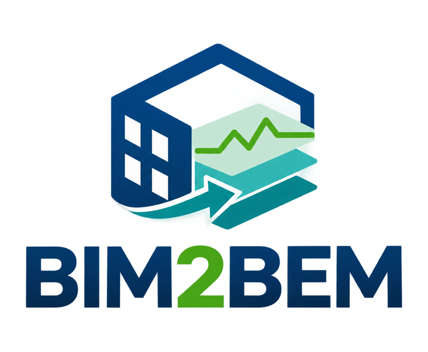

**From IFC model to building energy model, entirely in the browser.**

[Open the app](https://isaddiq.github.io/BIM2BEM/) ·
[Workflow](#workflow) ·
[What is calculated](#what-is-calculated) ·
[Data sources](#data-sources) ·
[Architecture](#architecture) ·
[Tests](#tests) ·
[Run locally](#run-locally) ·
[Limitations](#what-is-calculated)

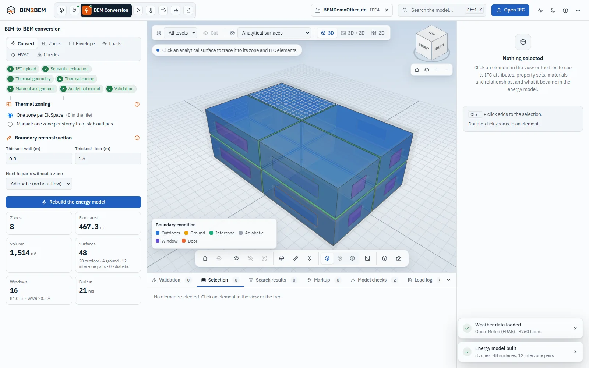

</div>

BIM2BEM converts an IFC building model into an EnergyPlus model, runs **EnergyPlus 26.2 compiled to WebAssembly** in the page with weather data for the building's real location, and evaluates energy demand and indoor environmental quality. It is a static site: no server, no account, no upload. IFC files are parsed and simulated on your machine.

Every number shown says where it came from: the **IFC file**, **IFC geometry** (calculated), **your entries**, an **open dataset**, a **documented reference library**, or a **reconstruction** by the conversion algorithm. Where an analysis cannot be calculated from the available inputs, the app says so instead of showing a value.

BIM2BEM grew out of BIM2Bot Lab. The IFC loading, 3D viewer, model tree, selection, property inspection and 2D floor plans are kept; the robot navigation and simulation features were removed.

## Workflow

| Stage | What happens |
| --- | --- |
| **BIM Model** | Open an IFC2x3, IFC4 or IFC4.3 file. Explore it in 3D and on 2D floor plans; inspect classes, property sets, materials and relationships. |
| **Location** | The app reads `IfcSite` coordinates and `TrueNorth` and asks you to confirm them (Revit's placeholder Boston location is flagged). Otherwise search the address (Nominatim / OpenStreetMap), pick on the map or type coordinates. Your own position is never used. |
| **Weather** | **Fetched automatically when you confirm the location**: a TMY3 file distributed with EnergyPlus if one is within 25 km (and 100 m elevation), otherwise the most recent complete year built from **Open-Meteo (ERA5)**, then **NASA POWER** if ERA5 is unreachable. The panel says which source was chosen and why. You can switch this off, build another year or source yourself in the Location tab, or upload your own EPW/ZIP at the top of the Energy Simulation tab (for example TMYx from climate.onebuilding.org); a file you choose is never replaced automatically. Files are validated: record count, hour sequence, ranges, completeness, dew point vs dry bulb, night-time radiation. |
| **BEM Conversion** | IfcSpace → thermal zones → surfaces, taken from the file's second-level space boundaries (`IfcRelSpaceBoundary2ndLevel`) where they are complete, otherwise reconstructed from the IfcSpace bodies → interzone pairs → exterior/ground/unmodelled classification → windows and doors → constructions. Each step is traceable (see below). |
| **Energy Simulation** | The IDF is validated against the engine's own schema, then EnergyPlus runs in a Web Worker. Scenarios (insulation, glazing, ventilation and heat recovery, natural ventilation, setpoints) are separate EnergyPlus runs. |
| **IEQ Analysis** | PMV/PPD (ISO 7730), adaptive comfort (EN 16798-1, ASHRAE 55) for free-running zones, CO₂, outdoor-air rates, daylight at one reference point per zone. Acoustics is listed as planned. |
| **Environment** | Wind rose and monthly wind from the EPW, sun path, monthly global radiation, incident solar radiation on the model's exterior surfaces. |
| **Results / Reports** | Demand, peaks, monthly and hourly charts, zone tables, scenario comparison; IDF, epJSON, IFC→BEM mapping (JSON/CSV), zones, hourly and zone results, IEQ, environment, assumptions, logs, weather metadata, a reproducibility manifest, and a printable report that includes only completed analyses. |

The 3D view switches between the BIM model, analytical surfaces, thermal zones, annual heating and cooling demand, hourly air temperature, PMV and CO₂ (with an hour slider), solar exposure on surfaces, outdoor-air rates and daylight. Colours always come from a number; a mode without data says what is missing. Selecting an IFC wall shows the analytical surfaces it produced, their boundary condition, construction, U-value and simulated incident solar radiation; clicking an analytical surface leads back to its zone and IFC elements.

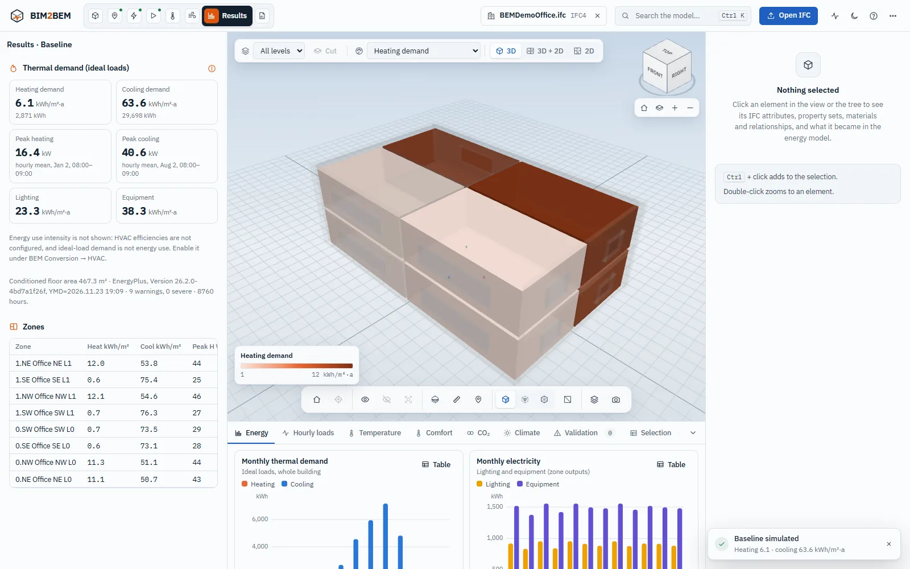

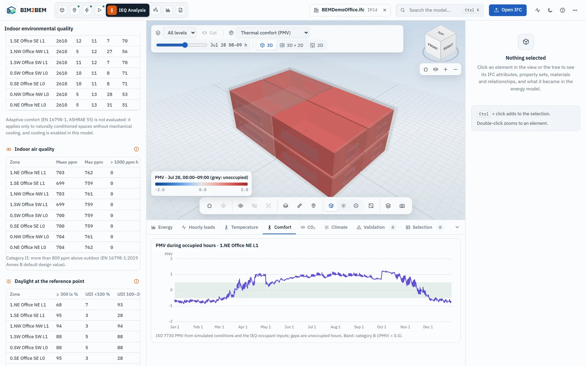

<table>
  <tr>
    <td width="50%">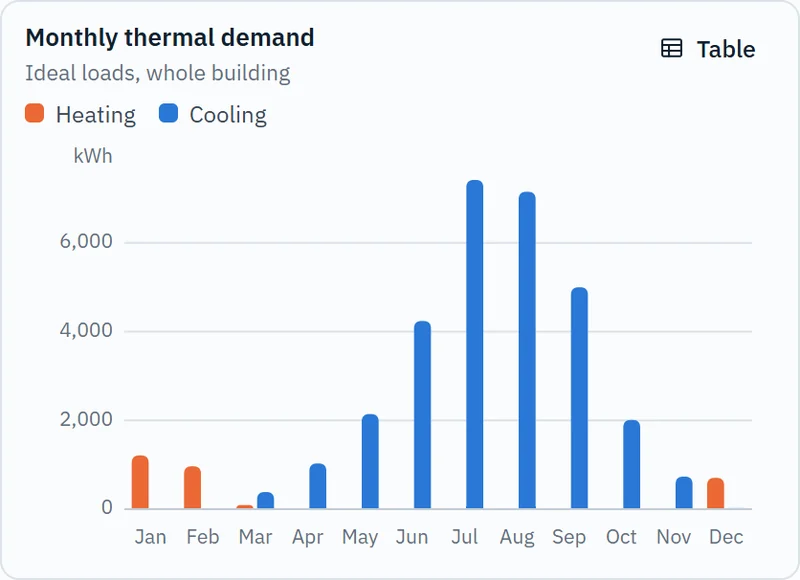</td>
    <td width="50%">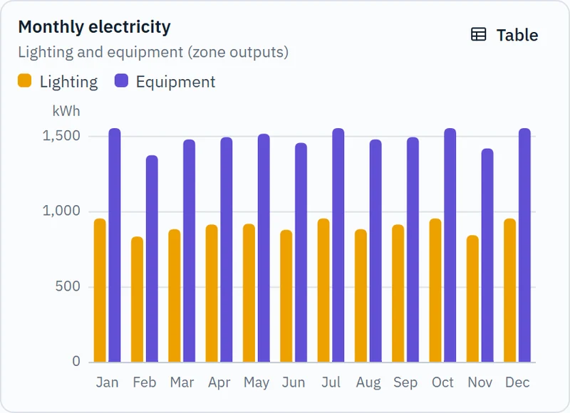</td>
  </tr>
  <tr>
    <td colspan="2">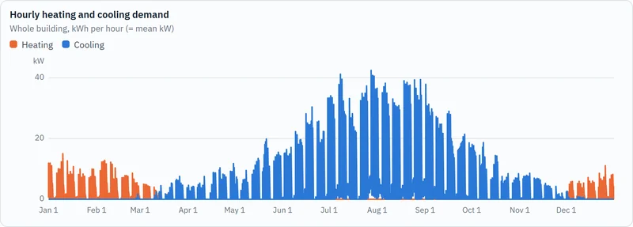</td>
  </tr>
  <tr>
    <td colspan="2">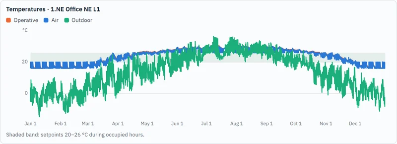</td>
  </tr>
  <tr>
    <td colspan="2">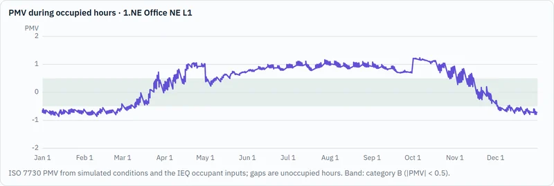</td>
  </tr>
  <tr>
    <td width="50%">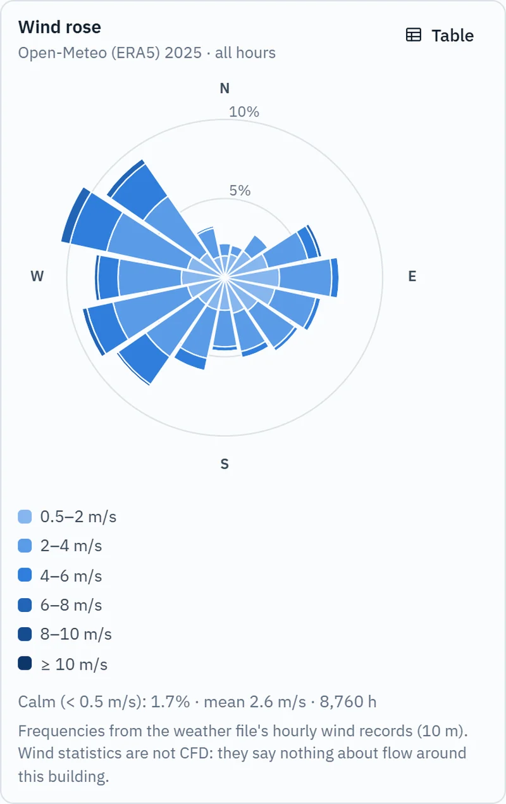</td>
    <td width="50%">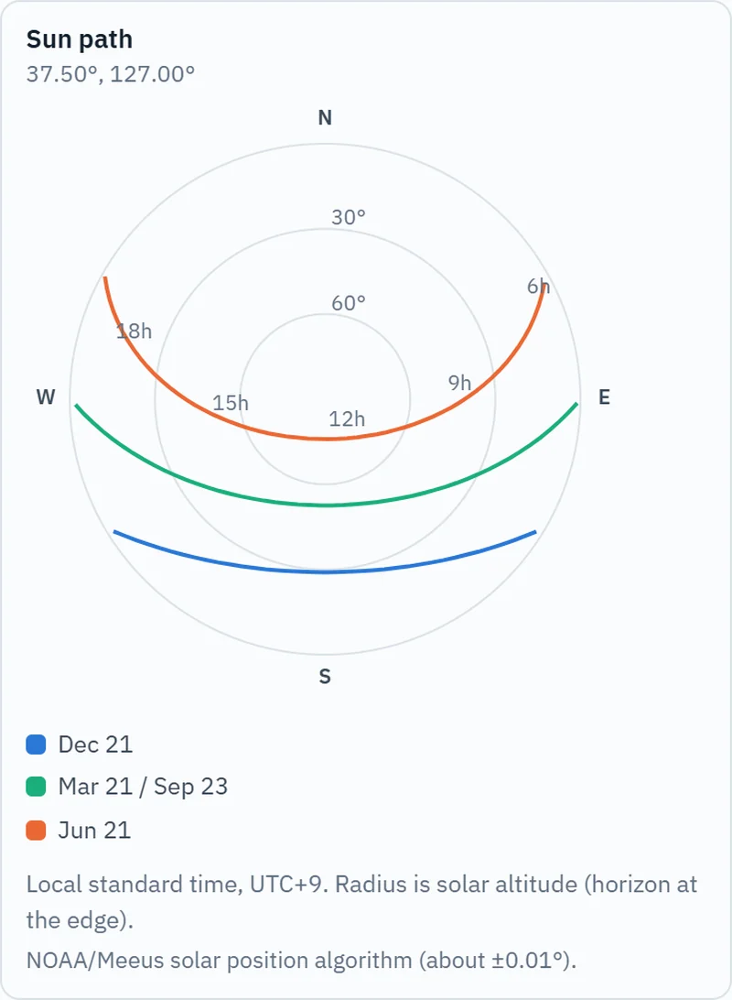<br />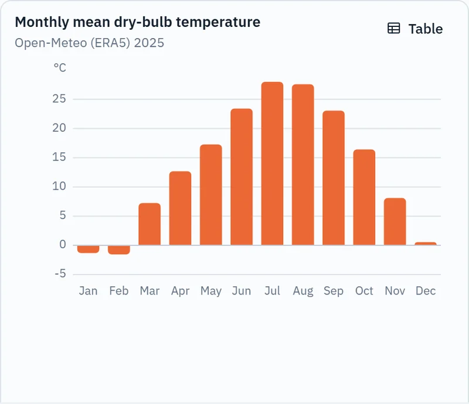</td>
  </tr>
</table>

<p align="center"><sub>BEM demo office in Seoul, weather selected automatically (ERA5 2025), EnergyPlus 26.2 run in the browser.</sub></p>

## What is calculated

**By EnergyPlus** (the engine, not BIM2BEM): heat balance, ideal-loads heating and cooling demand, zone temperatures, mean radiant and operative temperature, humidity, the zone CO₂ balance, infiltration and outdoor-air flows, wind- and stack-driven natural ventilation (`ZoneVentilation:WindandStackOpenArea`), slab-on-grade heat transfer (`Foundation:Kiva`), self-shading, incident and transmitted solar radiation, and split-flux daylight illuminance and glare index at reference points.

**By BIM2BEM, from EnergyPlus output**: annual, monthly and peak values; PMV/PPD; adaptive-comfort categories; CO₂ and daylight statistics over occupied hours.

**By BIM2BEM, from the weather file**: degree-days, design-temperature percentiles, an ASHRAE 169 thermal climate-zone number, wind rose, solar position.

**Not calculated**, and labelled as such in the app: annual grid daylight metrics (sDA, ASE), AirflowNetwork pressures and interzone airflow, CFD, particulates and VOCs, acoustics, detailed HVAC plant. *Ideal-loads demand is never presented as electricity or fuel*; HVAC energy is shown only when you enter conversion efficiencies, and is then labelled as a constant-efficiency estimate.

### IFC → BEM conversion, in short

1. **Zones**: one per `IfcSpace` with a body; external spaces are excluded. Files without spaces can use manual zoning (one zone per storey from slab outlines).
2. **Surfaces from the IFC's own room boundaries**, when the file has second-level space boundaries (`IfcRelSpaceBoundary2ndLevel` in IFC4; `IfcRelSpaceBoundary` named or described as 2nd level in IFC2x3). Their `IfcCurveBoundedPlane` / `IfcFaceBasedSurfaceModel` geometry is placed in the space's `ObjectPlacement` and in the meshes' frame. In **Automatic** mode a space uses them only if they are complete: readable and planar, on the IfcSpace body (within 5 cm), every normal pointing out of the space (point-in-body test), closed, and total area and enclosed volume within 2 % of the body. Otherwise that space is reconstructed and the Checks tab gives the reason. Interzone pairs then come from `CorrespondingBoundary`, Outdoors/Ground/unmodelled from `InternalOrExternalBoundary` (cross-checked by the ray test of step 5; disagreements are reported), and windows and doors from their child boundaries (`ParentBoundary`). Each surface keeps the GlobalId of its `IfcRelSpaceBoundary` and building element. The option is in the Convert tab: Automatic, the file's boundaries (used even where a check fails, with a warning), or reconstruction only.
3. **Surfaces reconstructed** (all other spaces): each closed space solid is split into planar faces with outward normals; closure is checked (area-vector balance).
4. **Interzone boundaries**: faces of two zones that face each other within a wall (≤ 0.8 m) or floor (≤ 1.6 m) thickness are intersected; the overlap becomes a pair of EnergyPlus `Surface` boundaries of equal area.
5. **Exterior, ground, unmodelled**: remaining faces cast rays outward through the IFC elements. Faces that leave the building become `Outdoors` (roofs, exposed floors) or `Ground` (lowest floors); faces that meet building parts without a zone (shafts, rooms without an `IfcSpace`) are set adiabatic or outdoors, as you choose, and reported. `IsExternal` properties are used to resolve mixed cases and to flag conflicts.
6. **Openings**: `IfcWindow`/`IfcDoor` bodies are projected onto the exterior surface they sit in (hosts from `IfcRelVoidsElement`/`IfcRelFillsElement` when present).
7. **Constructions**: IFC material layers with IFC thermal properties (`Pset_MaterialThermal`, `IfcThermalMaterialProperties`, …), in outside-first order derived from `IfcMaterialLayerSetUsage` and the element's placement; or a declared `ThermalTransmittance`; or library materials **you** assign to unresolved IFC materials; or, last, a documented reference construction. Thermal properties are never inferred from a material's name.
8. **Traceability**: every IFC element keeps the list of zones, surfaces and openings it produced (one-to-many), exported as JSON and CSV with GlobalIds, including the `IfcRelSpaceBoundary` GlobalId and whether the geometry was extracted from the IFC or reconstructed.

## Data sources

| Source | Used for | Notes |
| --- | --- | --- |
| [Open-Meteo historical API](https://open-meteo.com/en/docs/historical-weather-api) (ERA5, Copernicus C3S) | Actual-year EPW; time zone and terrain elevation | CC BY 4.0. 0.25° grid. No key. |
| [NASA POWER](https://power.larc.nasa.gov/) | Actual-year EPW (from 2001) | MERRA-2 / CERES. No key. |
| [EnergyPlus weather files](https://github.com/NREL/EnergyPlus/tree/develop/weather) | TMY3 for 17 US stations | Indexed by `scripts/gen-station-index.mjs`. |
| [Nominatim](https://nominatim.org/) / OpenStreetMap | Address search, map tiles | On submit only, ≤ 1 request/s; © OpenStreetMap contributors, ODbL. |
| ISO 10456:2007 Table 3, ISO 6946, ISO 7730, EN 16798-1, ASHRAE 62.1/55/169 | Reference materials, surface resistances, comfort, ventilation and climate-zone thresholds | Cited where used; values are editable assumptions. |

[climate.onebuilding.org](https://climate.onebuilding.org/) cannot be read from a browser page (no CORS), so its files are offered as an upload. Regional energy-code tables are not bundled: enter the requirements that apply to your project.

## Architecture

A static site with no bundler at run time: React 18 and Three.js from unpkg, and the app's JSX compiled by esbuild into scripts that publish their API on `window`.

```text
assets/js/core/      pure logic, also loaded by the Node tests
  ifcloader.jsx      web-ifc 0.0.35 parsing; georeferencing; material properties; placements
  geom.jsx           planar faces, polygon booleans (polygon-clipping), ray casting
  bem.jsx            IFC → thermal model, provenance, checks, traceability
  materials.jsx      reference library, U-values
  idf.jsx            epJSON-shaped model → IDF/epJSON, validated against the engine schema
  epmodel.jsx        thermal model + configuration + scenario → IDF
  results.jsx        engine output → building and zone results
  weather.jsx        EPW parse/validate/write, ERA5 and POWER → EPW, solar position, wind rose
  comfort.jsx        PMV/PPD, adaptive comfort, CO₂ and daylight indicators
  engine.jsx         lazy loader for EnergyPlus WebAssembly (@idfkit/engine)
assets/js/ui/        panels, charts, 3D result views, reports
assets/js/data/      generated: EnergyPlus schema subset, TMY3 station index
assets/vendor/       @idfkit/engine loader and worker, polygon-clipping, earcut
```

The EnergyPlus binary (~37 MB) is downloaded only when the first simulation runs, from `assets/energyplus/` when the deployment includes it (the Pages workflow does) or from the version-pinned package on jsDelivr. Opening an IFC file never downloads it.

## Tests

```bash
npm install
npm test               # 70+ functional and numerical checks, incl. real EnergyPlus runs in Node
npm run test:network   # adds weather built for Seoul, Singapore, Berlin and Denver
node tests/e2e.mjs     # drives Chrome/Edge through the whole workflow on the built site
```

The checks compare against independent references: hand calculations from the demo model's known geometry and layers, ISO 7730 Table D.1 and 60 cases from pythermalcomfort, an analytical CO₂ mass balance, EnergyPlus's own solar angles, and synthetic data with known answers. Each run writes its results to `tests/last-run.json`. Passing them verifies the listed behaviours; it does not validate the platform as a whole.

## Run locally

```bash
npm install
npm run build          # compile assets/js/**/*.jsx
npm run serve          # or any static server; open http://localhost:3000
```

Optional: `npm run vendor:engine` copies the EnergyPlus assets to `assets/energyplus/` (git-ignored); set `window.ENGINE_LOCAL_ASSETS = true` in `assets/js/data/engine-config.js` to use them instead of the CDN.

Regenerate data: `npm run gen:schema` (after upgrading `@idfkit/engine-assets`), `npm run gen:stations`, `npm run gen:sample` (needs Python with IfcOpenShell 0.8).

## Deploy to GitHub Pages

`.github/workflows/pages.yml` builds, runs the tests, copies the EnergyPlus assets next to the site and publishes it. In the repository settings, set **Pages → Source** to **GitHub Actions**. All paths are relative, so the site works under a repository subpath.

## Sample models

| Model | Purpose |
| --- | --- |
| **Seoul Exchange Tower** (`assets/ifc/SeoulExchangeTower.ifc`) | Default demo model ("Try the demo tower"). Multidisciplinary IFC4 concept model: ground floor plus seven office storeys, 104 rooms, 256 windows, structure, HVAC, plumbing and electrical elements, materials with `Pset_MaterialThermal`, 1,322 second-level space boundaries and a site in Seoul. The building is fictional. |
| **BEM demo office** (`assets/ifc/BEMDemoOffice.ifc`) | Reference model generated by `scripts/make_sample_bem_office.py`: two storeys, eight rooms, IFC4 material layer sets with thermal properties, glazing properties, site coordinates and a rotated true north. Every dimension and U-value is known, so it is the conversion test case. The building is fictional. |
| **BEM demo office with space boundaries** (`assets/ifc/BEMDemoOffice-SB.ifc`) | The same model plus 64 second-level space boundaries (48 room faces with `CorrespondingBoundary` links, 16 window boundaries), written by `make_sample_bem_office.py --space-boundaries`. Both surface sources must give the same model. |
| **Research centre** | Four storeys, 56 rooms; no thermal data, so reference constructions apply. |
| **Office blocks** | Revit IFC2x3 export (BIM Whale samples, MIT); unresolved materials and declared window/door U-values. |

## Credits and licences

MIT licence. EnergyPlus is developed by NREL and the U.S. Department of Energy and is distributed under its own licence (see `@idfkit/engine-assets`); BIM2BEM is not affiliated with or endorsed by them. web-ifc (MPL-2.0), Three.js, React, polygon-clipping (MIT), earcut (ISC), Leaflet (BSD-2-Clause). Icons: see `assets/icons/flaticon/ATTRIBUTION.md`. Office blocks sample model: BIM Whale samples by André Wisén, MIT (see `assets/ifc/LICENSE-LargeBuilding.txt`).
